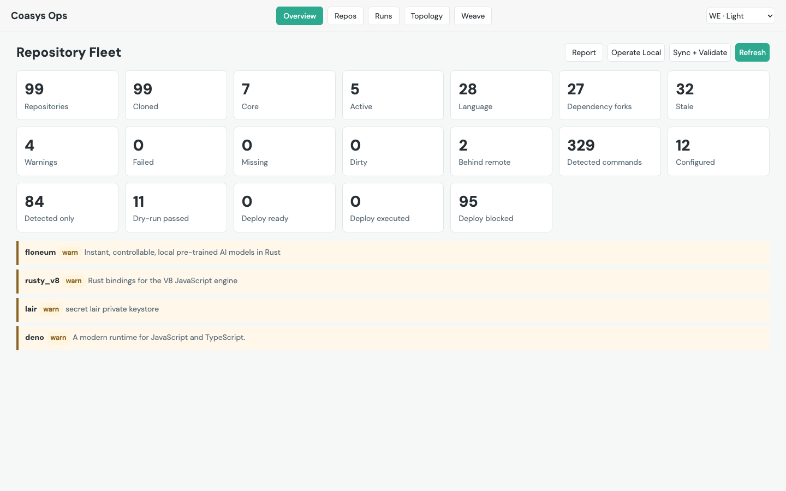

# Coasys Repository Operations Dashboard

Coasys Ops is a local control plane for public Coasys repositories. The
command line and dashboard share a SQLite inventory, and Weave describes
repository configuration, dependencies, and deployment readiness.



Use Python 3.13 or later and uv. From the checkout:

```sh
uv sync --locked --extra dev
uv run --no-sync coasys status
uv run --no-sync coasys serve --host 127.0.0.1 --port 5050
```

Open [the local dashboard](http://127.0.0.1:5050). The
[documentation index](docs/README.md) covers the CLI, API, configuration,
operations, and verification. The [software manuscript](docs/manuscript/README.md)
describes the design and its evidence.

Released under the [MIT License](LICENSE).
